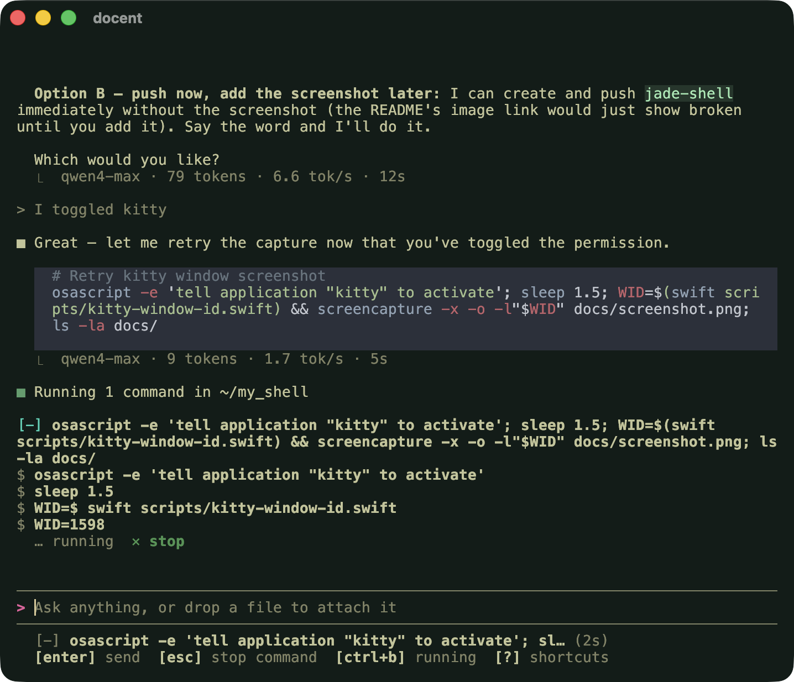

# 🐚 jade-shell

A one-script macOS terminal makeover: **kitty** + **Starship** + **Hack Nerd Font**, with 8 hand-tuned color themes — including the signature **Osaka Jade**.



## What it does

Running `./my-kitty` will:

1. Install **kitty** (via Homebrew cask) if missing
2. Install the **Starship** prompt if missing
3. Install **Hack Nerd Font** into `~/Library/Fonts` if missing
4. Write `~/.config/kitty/kitty.conf` + `current-theme.conf` in your chosen theme
5. Write a matching `~/.config/starship.toml` (prompt colors follow the theme)
6. Hook Starship into `~/.zshrc` (idempotent — safe to re-run)

Everything is skipped if already installed, so re-running with a different `--theme` just re-skins your terminal.

## Themes

| # | Theme | Vibe |
|---|-------|------|
| 1 | `github-dark` | GitHub's dark palette |
| 2 | `dracula` | Classic purple/pink |
| 3 | `gruvbox-dark` | Warm retro groove |
| 4 | `tokyo-night` | Cool neon blues |
| 5 | `catppuccin-mocha` | Soft pastels |
| 6 | `osaka` | Tokyo Night Osaka |
| 7 | `jade` | Calm greens |
| 8 | `osaka-jade` | craftzdog / Omarchy Osaka Jade ⭐ |

## Requirements

- macOS with [Homebrew](https://brew.sh)
- **bash ≥ 4** (the script uses `declare -A`; macOS ships bash 3.2). Install with `brew install bash` — Homebrew's bash lives at `/opt/homebrew/bin/bash`.

## Usage

```bash
# Interactive theme menu
/opt/homebrew/bin/bash ./my-kitty

# Or pick a theme directly
/opt/homebrew/bin/bash ./my-kitty --theme osaka-jade
```

Then launch kitty:

```bash
open -a kitty
```

Already inside kitty? Reload the config with `ctrl+shift+f5`.

## License

MIT — see [LICENSE](LICENSE).
